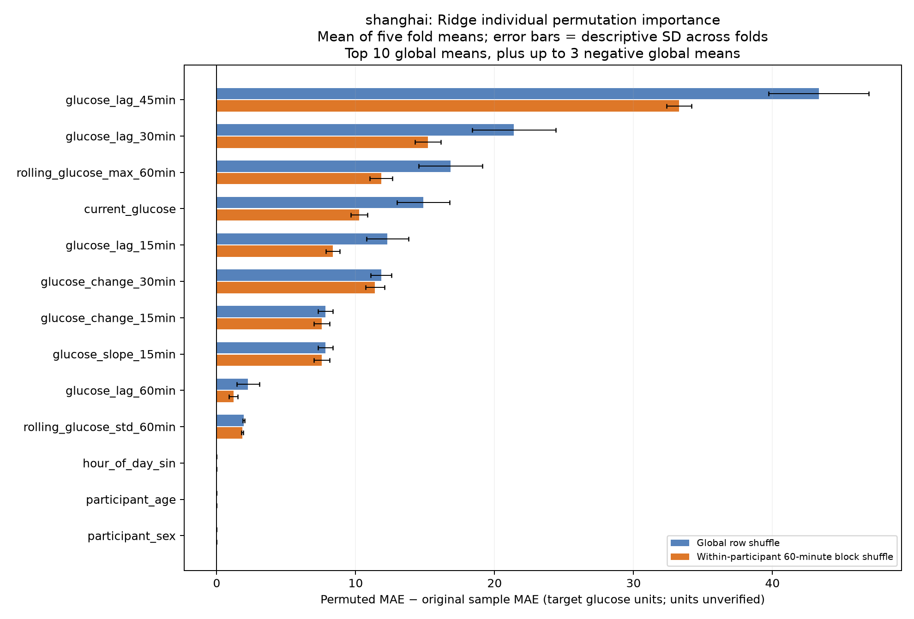
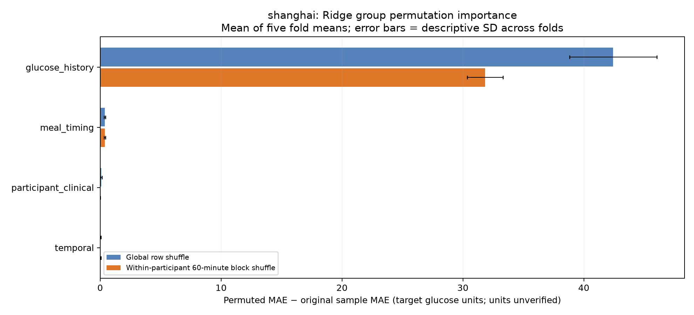
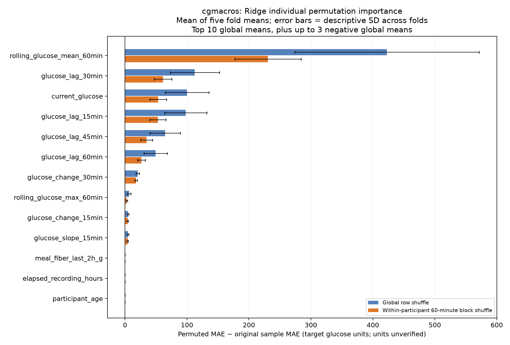
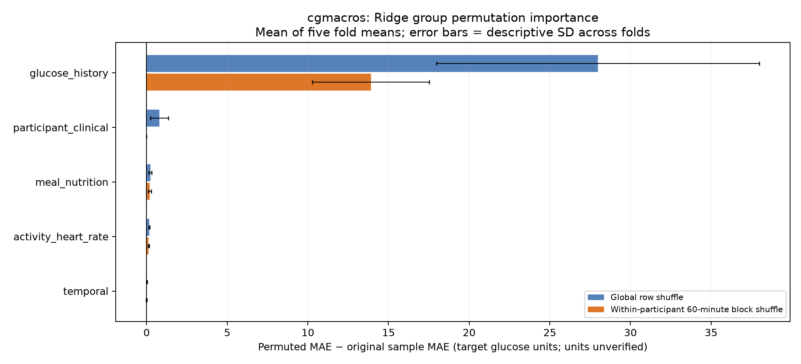

# Member 4: held-out Ridge permutation importance

Completed 2026-11-04 (Asia/Colombo). All approved features, both datasets, and the same five participant-wise development folds. Importance = **permuted MAE − original MAE** on the exact same held-out sample. Positive values mean worse predictions after permutation; negative values are retained.

## Models, sample and pilot

All ten training-fold Ridge pipelines were reused from the coefficient-analysis cache, with model, source-data, split, feature-order, hyperparameter and participant-membership hashes verified. No models, imputers or scalers were fitted. Sampling used no glucose targets. Locked-test participant rows were filtered out before any measurement analysis or prediction.

The Shanghai Fold 1 pilot ran the complete individual/group analysis with both schemes and 10 repeats in **23.76 seconds** (fold preparation and scoring; excludes initial file hashing/loading). Its observed runtime was inspected before processing the remaining nine folds. The pilot scores were reused rather than recomputed. The pilot-only ten-fold projection was 237.6 seconds; dataset-specific preparation times make this a rough estimate.

Master seed **42**, 10 repeats per item/scheme/fold, NumPy PCG64 generators. Per-participant sample seeds and per-repeat permutation seeds are derived by stable SHA-256 hashing and saved. A single repeat uses the same donor mapping for different items (paired randomness); every column in a group receives that exact same mapping.

The sample contains equal numbers of complete observed 60-minute blocks for every development participant within a dataset, capped at 480 rows per participant. Shanghai uses the audited 15-minute nominal interval (4 observations per block); CGMacros uses 1 minute (60 observations per block). Blocks do not cross missing-interval boundaries. Samples select blocks without replacement across the eligible recording and retain their chronological internal order. One block covers one nominal hour of sampling slots: its first-to-last observed timestamp span is 45 minutes for Shanghai or 59 minutes for CGMacros.

The shared block quota is limited by the least-covered development participant rather than excluding shorter recordings. All held-out participants remain represented. Rows outside selected blocks, including incomplete segment tails, are not scored in this sampled analysis; they remain in the source and trained models are unchanged. Global row shuffling uses this same block-selected sample for a paired comparison. This is not a simple random sample of all individual time-series rows.

| Dataset | Rows per participant | Selected blocks per participant | Block rows | Participants covered across folds | Total sample rows | Incomplete segment-tail rows ineligible for sampling |
|---|---:|---:|---:|---:|---:|---:|
| shanghai | 240 | 60 | 4 | 80 | 19,200 | 165 |
| cgmacros | 480 | 8 | 60 | 36 | 17,280 | 2395 |

Exact selected development-row indices, participant IDs, timestamps, block IDs and selection seeds are saved in `*_selected_rows.local.csv`; participant coverage, sample fractions and eligible-block counts are in `*_sample_coverage.local.csv`. These participant-linked files are ignored by Git. Runtime sidecars record selection/model hashes, row/participant counts and sample fractions. No row-level glucose predictions are saved.

Because every sampled participant contributes the same row count, sample MAE equals the mean of participant-specific sample MAEs within a fold. These baselines describe the selected sample; they are not replacements for Member 3’s full, row-weighted validation scores.

## Permutation schemes and interpretation

**Global row shuffle:** permute donor rows over the entire held-out fold sample, including across participants. This disrupts temporal structure and can combine incompatible glucose histories, demographics, meals and activity. Individual permutations can violate algebraic relationships among current glucose, lags, changes and rolling features. Large losses can reflect off-distribution stress, especially for correlated Ridge predictors, and must not be read as causal or independent medical importance.

**Within-participant block sensitivity:** reorder the selected complete 60-minute donor blocks within each participant, preserving order inside each block and using the same permutation for every column in an item/group. Participants are never mixed, and donor blocks never internally cross original recording gaps. This retains local structure more than global row shuffling, but disrupts longer trajectories, clock-time alignment, inter-block continuity and dependencies with unpermuted features. The block length is an exploratory choice, not an optimized or validated physiological timescale. Fixed points are allowed and their changed-row/value fractions are recorded.

Participant-constant features cannot be perturbed by within-participant reordering. Their zero block importance is **not identifiable under this scheme**, not evidence that the model ignores them. The results explicitly record how many participants have constant inputs in the sample and full validation data. The same limitation applies if a time-varying feature happens to be constant in selected windows. The clinical group is uninformative under this scheme when all its columns are participant-constant.

Feature groups follow the approved `feature_group` metadata exactly. Shared donor rows preserve within-group associations in each relocated row/block, but relationships to other groups and targets are broken. Group importance is not the sum of individual importances; the schemes also measure different disruptions and their numerical values are not interchangeable.

## Results

### shanghai

Sample baseline MAE by fold: 1: 9.6624, 2: 9.6838, 3: 9.8507, 4: 9.7676, 5: 9.7119. Target glucose units remain unverified in the supplied metadata; no mg/dL or mmol/L conversion was applied.

| Approved feature group | Global importance mean ± fold SD | Within-participant block mean ± fold SD | Negative global fold means / 5 |
|---|---:|---:|---:|
| glucose_history | +42.43 ± 3.607 | +31.83 ± 1.477 | 0 |
| meal_timing | +0.3864 ± 0.07065 | +0.3746 ± 0.05603 | 0 |
| participant_clinical | +0.09232 ± 0.07205 | +2.107e-05 ± 3.211e-05 | 0 |
| temporal | +0.0451 ± 0.0284 | +0.04536 ± 0.01878 | 0 |

Clinical inputs are fully constant within 76/80 development participants. The other 4 have within-participant value or missingness variation (`nunique(dropna=False)`). Accordingly, a clinical block result need not be exactly zero for those participants. No source values were repaired or forced constant.

**Global row, five largest individual mean losses:** glucose_lag_45min: +43.3384; glucose_lag_30min: +21.3888; rolling_glucose_max_60min: +16.8335; current_glucose: +14.8829; glucose_lag_15min: +12.2907.

Global row negative individual mean losses (retained): hour_of_day_sin: -0.00156059; participant_age: -0.00179331; participant_sex: -0.00343048.

**Within-participant block, five largest individual mean losses:** glucose_lag_45min: +33.2792; glucose_lag_30min: +15.1999; rolling_glucose_max_60min: +11.8423; glucose_change_30min: +11.3978; current_glucose: +10.2506.

Within-participant block negative individual mean losses (retained): diabetes_duration_years: -6.8174e-06; hour_of_day_sin: -0.000873693.





### cgmacros

Sample baseline MAE by fold: 1: 7.0875, 2: 8.3199, 3: 7.5869, 4: 7.0526, 5: 9.0353. Target glucose units remain unverified in the supplied metadata; no mg/dL or mmol/L conversion was applied.

| Approved feature group | Global importance mean ± fold SD | Within-participant block mean ± fold SD | Negative global fold means / 5 |
|---|---:|---:|---:|
| glucose_history | +27.99 ± 10 | +13.9 ± 3.612 | 0 |
| participant_clinical | +0.7949 ± 0.5455 | +0 ± 0 | 0 |
| meal_nutrition | +0.2303 ± 0.0864 | +0.1985 ± 0.08429 | 0 |
| activity_heart_rate | +0.1653 ± 0.02458 | +0.1246 ± 0.03804 | 0 |
| temporal | +0.01244 ± 0.02957 | +0.002459 ± 0.02425 | 1 |

Clinical inputs are fully constant within all 36 development participants. As expected, the clinical group has exactly zero block importance: this scheme cannot identify reliance on between-participant clinical differences.

**Global row, five largest individual mean losses:** rolling_glucose_mean_60min: +422.6396; glucose_lag_30min: +112.6079; current_glucose: +100.1321; glucose_lag_15min: +98.0104; glucose_lag_45min: +64.6475.

Global row negative individual mean losses (retained): current_mets: -0.000783694; current_activity_calories_last_min: -0.00128574; meal_fiber_last_2h_g: -0.00293995; elapsed_recording_hours: -0.0033435; participant_age: -0.0186328.

**Within-participant block, five largest individual mean losses:** rolling_glucose_mean_60min: +230.7112; glucose_lag_30min: +61.5370; current_glucose: +53.4989; glucose_lag_15min: +53.0378; glucose_lag_45min: +34.8043.

Within-participant block negative individual mean losses (retained): elapsed_recording_hours: -0.0025427; current_activity_calories_last_min: -0.00268431; meal_fiber_last_2h_g: -0.00563178.





The CGMacros rolling-mean individual global loss (+422.6396) is far larger than the glucose-history group loss (+27.9895). Moving the related glucose-history columns together preserves their within-row relationships, whereas moving the rolling mean alone breaks the relationships underlying large compensating Ridge coefficients. This contrast supports treating the individual loss as a perturbation stress result rather than an independent medical contribution; block shuffling reduces but does not eliminate these interpretation limitations.

## Descriptive variation and verification

Saved **7,300** fold/repeat scores, including **1,088 negative scores**, **730** fold summaries, **146** aggregate summaries, and **10** sample baselines. No negative value was clipped or reset to zero.

Repeats are first summarized within each fold/item/scheme. The principal aggregate is the unweighted mean of five fold means, with descriptive sample SD and range across those five means. Fold sizes differ, so this equal-fold summary is not a pooled participant-weighted effect across the entire dataset. Repeat SDs measure permutation variability conditional on the fixed fitted model and sampled rows. Time-series rows and repeats are not treated as independent participants; no confidence intervals, p-values or significance claims are made. The overlapping fold training sets also limit independence.

A negative loss means that this particular perturbation lowered sample MAE. It may reflect sampling/permutation variation, redundancy or model dependence that does not help on that sample. It is not proof that a feature should be removed or a model retuned. No new model-selection decision was made from these importances.

All **252** protected source files and **20** cached model/sidecar files retained their hashes. Model fits: **0**. Final-test predictions: **0**. Five synthetic tests passed for deterministic balanced gap-safe sampling, within-person block mapping, one shared group mapping, positive/negative MAE-loss conventions, and the participant-constant limitation.

Main files: `permutation_aggregate_summary.csv`, `permutation_fold_summaries.csv`, `permutation_sample_baselines.csv`, ten `*_repeat_results.csv` files, ten runtime JSON sidecars, `reports/member4/permutation_pilot.json` and `permutation_analysis_evidence.json`. Four plots are saved in `results/member4/figures/`. The original notebook provenance discrepancy and glucose-unit uncertainty from the readiness/data audits remain disclosed; the fitted cache/source model hashes used here match their recorded values.

## Reproduction

```powershell
python -B notebooks/member4/test_permutation_importance.py
# Pilot: inspect its saved runtime before the next command.
python -B notebooks/member4/permutation_importance.py --source-root C:\Users\mssmo\Documents\glucose\Smart_Glucose_Work
python -B notebooks/member4/permutation_importance.py --source-root C:\Users\mssmo\Documents\glucose\Smart_Glucose_Work --run-all
python -B notebooks/member4/verify_permutation_results.py --source-root C:\Users\mssmo\Documents\glucose\Smart_Glucose_Work
python -B notebooks/member4/report_permutation_importance.py
```

The saved-result verifier checks the exact held-out IDs, locked-ID exclusion, balanced counts, unique source rows, block continuity, selection/result hashes, seeds, MAE-loss arithmetic, conditional constancy, and reconstruction of fold/aggregate means. Its status is saved in `reports/member4/permutation_verification.json`; it performs no model fitting or prediction.

The full run requires a completed pilot with the exact configuration/script hash. Completed fold outputs are reused only when script, sample, model, package/configuration identity and output hashes match. Incompatible or incomplete results fail rather than being overwritten automatically. Predictions always go through the fitted original preprocessing pipeline; clinical/sex categorical columns are permuted at original-input level.

Method reference: [scikit-learn permutation importance](https://scikit-learn.org/stable/modules/permutation_importance.html). The custom grouped/block schemes and sampling protocol are documented above; they are exploratory extensions, not claims of conditional or causal importance.

**Member 4 development-only permutation importance: COMPLETE. Final-test evaluation: NOT STARTED.**
