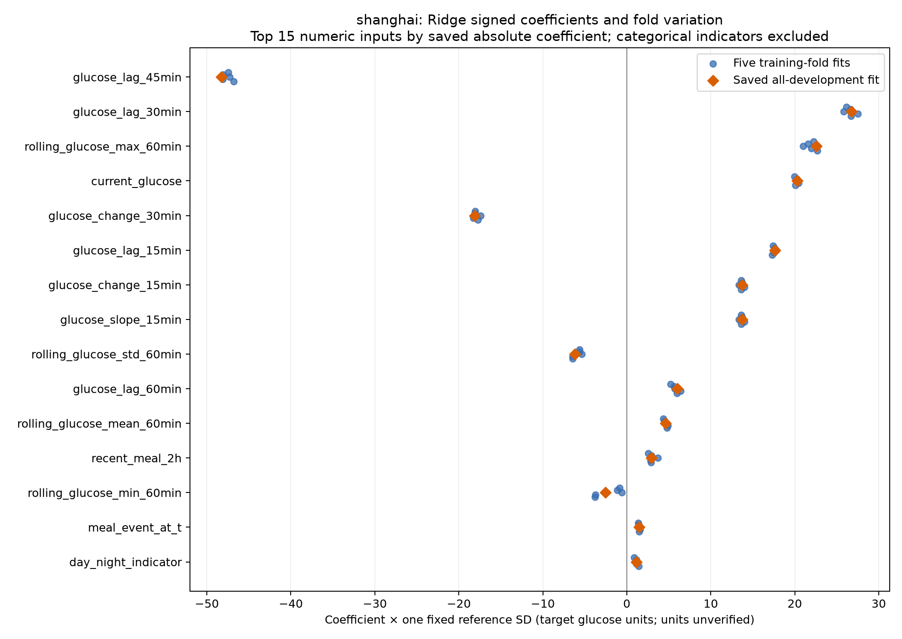
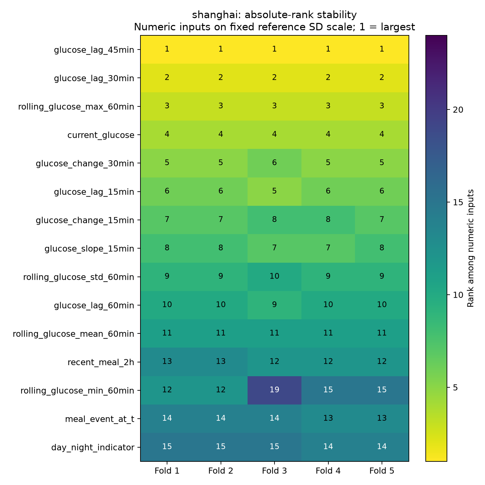
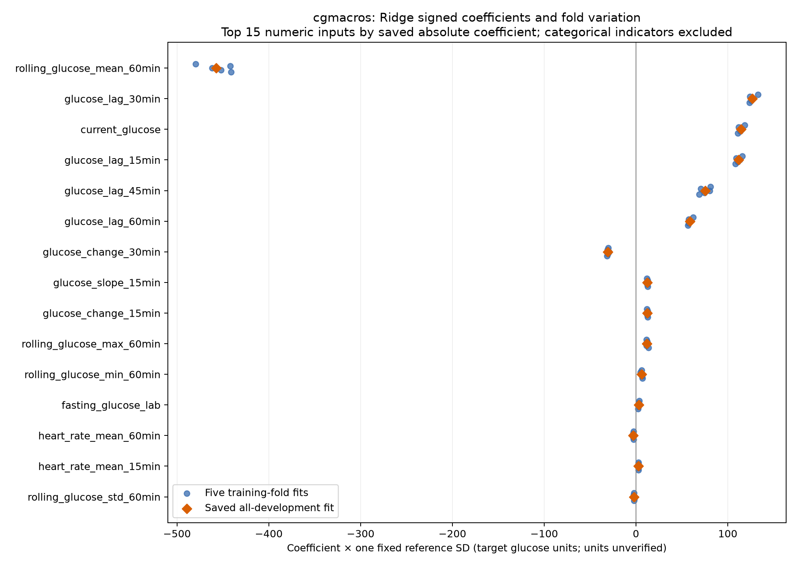
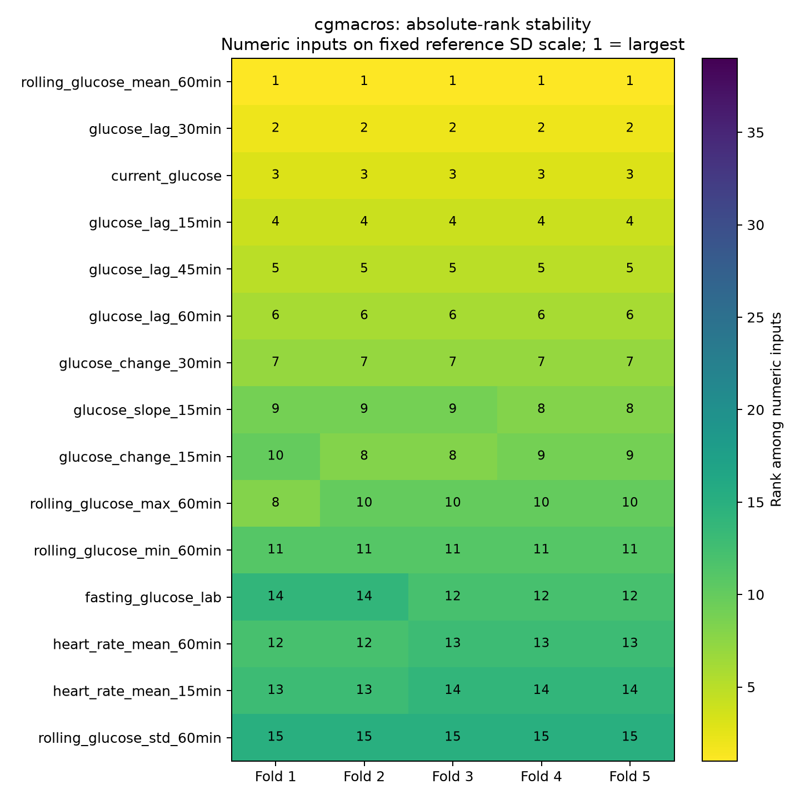

# Member 4: Ridge coefficient interpretation

Analysis completed 2026-11-04 (Asia/Colombo). Both datasets use all approved features. This report distinguishes the original saved development-fitted models from five training-only fold fits per dataset.

## Scope and provenance

Shanghai uses 91,829 development rows from 80 participants; CGMacros uses 534,235 rows from 36 participants. The saved participant assignments were reused exactly. Shanghai validation-fold sizes are 16/17/16/16/15; CGMacros sizes are 7/7/7/7/8. Every training set is disjoint from its validation participants and locked-test participants.

Protected files checked: **252**; changes: **0**. Saved Ridge hashes match the Member 3 inventory. No hyperparameter search or model-selection experiment was repeated. No final-test predictions were made. Predictions on up to 32 development fitting rows per model were used only for algebraic reconstruction checks, not performance reporting.

The readiness audit found no compatible fold models. Ten cloned pipelines were fitted once on the existing training partitions and cached under `models/member4/`; subsequent compatible runs reuse them. Cache sidecars record source/model/data/split/feature hashes, unchanged hyperparameters, package versions and hashed participant membership. The models and sidecars stay local and are ignored by Git. The aggregate analysis evidence records how each cache was obtained.

The original modeling-notebook checksum discrepancy recorded in the readiness audit remains unresolved; the ten original model hashes independently match their inventory. The available Python 3.13.15 differs from the original Python 3.14.3, while the recorded core package versions match. No original pipeline was overwritten.

## Coefficient scales and categorical coding

For each numeric input, the fitted transformation is z = (imputed x − training mean) / training scale. The signed transformed coefficient b describes a one-training-SD change. The original-unit slope is b / training scale. Its numeric-system intercept is the transformed intercept minus the sum of these slopes × training means. Both intercepts and per-model imputation/scale statistics are saved.

Fold scales differ. To compare coefficients across folds, the original-unit slope is multiplied by one fixed reference SD from the saved all-development scaler. Thus common-reference coefficient = (fold b / fold scale) × saved reference SD. This rescaling occurs only after fitting and never affects model inputs, regularization or tuning. It is descriptive and uses the development-wide reference solely as a common ruler. Constant reference inputs are excluded from numeric magnitude ranks.

Absolute numeric ranks use this reference-SD scale; 1 means largest magnitude among numeric inputs within that dataset. The tables also preserve raw transformed coefficients and ranks within transform kind. Categorical indicators are unscaled 0/1 columns and are ranked separately; their raw magnitude must not be compared with standardized numeric magnitudes as if the units matched. A one-SD comparison is a model sensitivity convention, not a clinical effect or an independent feature-importance measure. Binary/indicator-like numeric features have SDs that depend on prevalence.

Shanghai has 24 standardized numeric inputs and participant_sex expanded into Female and Male indicator columns, for 26 transformed columns from 25 inputs. The encoder uses `drop=None`: **there is no dropped reference category**. Individual dummy coefficients are offsets in this full coding, not effects relative to Female. The interpretable coding contrast is b_Male − b_Female with other predictors fixed. Unknown categories use `handle_unknown="ignore"` (all-zero coding); that is not a deliberately fitted clinical reference group.

CGMacros has 39 standardized numeric columns. `participant_sex_code` remains the approved numeric-coded input; there is no one-hot reference category. Its original-unit slope describes a one-code increment, but the supplied artifacts do not establish the meaning of the codes, so no sex-specific biological conclusion is assigned.

## Dataset findings

### shanghai

Ridge alpha = 10; 25 original inputs and 26 transformed columns. 23/24 numeric inputs retain the same nonzero sign in all five fits. Mean pairwise Spearman agreement of absolute numeric ranks is 0.974.

Coefficients below are in target-glucose units per fixed reference SD. Glucose measurement units remain unverified in the supplied metadata.

| Numeric input | Saved signed coefficient | Fold mean ± SD | Fold ranks, min–max | Same nonzero sign in all folds? |
|---|---:|---:|---:|:---:|
| glucose_lag_45min | -48.2505 | -47.5586 ± 0.5551 | 1–1 | Yes |
| glucose_lag_30min | +26.7316 | +26.5725 ± 0.6303 | 2–2 | Yes |
| rolling_glucose_max_60min | +22.5866 | +21.8992 ± 0.6422 | 3–3 | Yes |
| current_glucose | +20.3100 | +20.1965 ± 0.1838 | 4–4 | Yes |
| glucose_change_30min | -18.1199 | -17.9208 ± 0.3409 | 5–6 | Yes |
| glucose_lag_15min | +17.6498 | +17.5371 ± 0.1887 | 5–6 | Yes |
| glucose_change_15min | +13.7123 | +13.6540 ± 0.2264 | 7–8 | Yes |
| glucose_slope_15min | +13.7123 | +13.6540 ± 0.2264 | 7–8 | Yes |

Features with fold-to-fold sign changes: hour_of_day_sin. Near-zero is defined as absolute coefficient ≤ 1e-8 on the reported comparison scale; this is a numerical rule, not a threshold of clinical relevance.

Shanghai's saved **Male minus Female** contrast is +0.2673 target-glucose units. The five training-fold contrasts range from +0.0264 to +0.5219. These are conditional fitted-model offsets, not causal or clinical effects.

Largest observed absolute glucose-history correlations include: glucose_change_15min versus glucose_slope_15min: r=1.000000; glucose_lag_30min versus rolling_glucose_mean_60min: r=0.994426; glucose_lag_45min versus rolling_glucose_mean_60min: r=0.983314; glucose_lag_15min versus rolling_glucose_mean_60min: r=0.983282. Correlations are descriptive, row-weighted within development data, and no p-values are inferred from time-series rows.





### cgmacros

Ridge alpha = 0.1; 39 original inputs and 39 transformed columns. 32/39 numeric inputs retain the same nonzero sign in all five fits. Mean pairwise Spearman agreement of absolute numeric ranks is 0.934.

Coefficients below are in target-glucose units per fixed reference SD. Glucose measurement units remain unverified in the supplied metadata.

| Numeric input | Saved signed coefficient | Fold mean ± SD | Fold ranks, min–max | Same nonzero sign in all folds? |
|---|---:|---:|---:|:---:|
| rolling_glucose_mean_60min | -457.2444 | -455.3541 ± 15.9213 | 1–1 | Yes |
| glucose_lag_30min | +126.6988 | +126.3488 ± 3.8019 | 2–2 | Yes |
| current_glucose | +114.5472 | +114.0932 ± 3.0307 | 3–3 | Yes |
| glucose_lag_15min | +111.9247 | +111.4461 ± 2.9766 | 4–4 | Yes |
| glucose_lag_45min | +75.4160 | +75.0051 ± 5.5728 | 5–5 | Yes |
| glucose_lag_60min | +58.6358 | +58.3850 ± 2.2564 | 6–6 | Yes |
| glucose_change_30min | -30.6509 | -30.5545 ± 0.8807 | 7–7 | Yes |
| glucose_slope_15min | +12.2070 | +12.1919 ± 0.5507 | 8–9 | Yes |

Features with fold-to-fold sign changes: hour_of_day_sin, elapsed_recording_hours, participant_age, participant_bmi, hba1c_lab, current_mets, current_activity_calories_last_min. Near-zero is defined as absolute coefficient ≤ 1e-8 on the reported comparison scale; this is a numerical rule, not a threshold of clinical relevance.

The saved participant_sex_code slope is +0.5171 target-glucose units per code increment (code meanings unverified).

Largest observed absolute glucose-history correlations include: glucose_change_15min versus glucose_slope_15min: r=1.000000; glucose_lag_30min versus rolling_glucose_mean_60min: r=0.995292; glucose_lag_45min versus rolling_glucose_mean_60min: r=0.980041; glucose_lag_15min versus rolling_glucose_mean_60min: r=0.980029. Correlations are descriptive, row-weighted within development data, and no p-values are inferred from time-series rows.





## Interpretation limits

Current glucose, lagged glucose, changes, slopes and overlapping rolling summaries encode much of the same signal. In both datasets, glucose_change_15min and glucose_slope_15min are almost perfectly correlated. Consequently, a large negative lag coefficient does not mean that lower past glucose causes higher future glucose. It is one conditional weight in a redundant representation. Holding every derived feature fixed while changing only one underlying glucose value may be physically impossible.

Ridge regularization stabilizes the joint prediction but does not identify a unique medical contribution from each correlated feature. Signals can be shared or offset across coefficients. In CGMacros, the large negative rolling-mean coefficient coexists with large positive current/lag coefficients; these are compensating weights in a redundant representation. Stable signs and ranks across these five overlapping training sets show sensitivity to the chosen participant omissions; they do not establish causation, independent importance, statistical significance or robustness to a different feature representation. Fold SDs are descriptive, not confidence intervals or standard errors. A negative sign is not a protective factor. Tiny numeric differences between almost equal change/slope coefficients can swap adjacent ranks; these swaps should not be presented as meaningful importance differences.

Shanghai glucose_plus_meal had mean validation MAE 9.54045388 versus 9.54220975 for all features, a difference of approximately 0.001756. This coefficient analysis retains all approved features as its primary scope and makes no superiority claim or new selection decision. No secondary feature-set models were fitted.

Units remain unverified, and no mg/dL or mmol/L label is inferred from value ranges. Numeric coefficient magnitudes are not compared across datasets because reference distributions and feature definitions differ. Missing inputs retain the original fitted imputation policy; this report does not independently audit missingness mechanisms. Fits retain the existing row-weighted training protocol, so participants with longer recordings contribute more rows; the fold stability summary does not make training participant-balanced.

## Outputs and reproduction

Tables in `results/member4/explainability/`: saved coefficients, fold coefficients, coefficient stability, category contrasts (Shanghai), fold rank correlations, glucose-history correlation matrices/pairs, intercepts and reconstruction checks. All numeric and categorical coefficients are included in tables; the figures show the 15 largest saved numeric magnitudes for readability.

The coefficient tables include transformed names, original features, feature groups, signed and absolute coefficients, original-unit slopes, imputation statistics, scale/centering, reference SD, separate ranks and categorical coding. Stability tables contain positive/negative/zero fold counts, sign agreement with the saved fit, coefficient/rank mean, SD and range, and numeric top-five frequency.

```powershell
python -B notebooks/member4/test_ridge_coefficients.py
python -B notebooks/member4/ridge_coefficients.py --source-root C:\Users\mssmo\Documents\glucose\Smart_Glucose_Work
python -B notebooks/member4/report_ridge_coefficients.py
```

The three synthetic tests check output-position mapping with reordered preprocessing branches and underscored category names, missing values and a constant feature; agreement of a category contrast with a prediction difference; and separation of reference rescaling from fitted coefficients. All 12 real fitted pipelines (2 original + 10 fold clones) passed transformed and original-scale prediction reconstruction on development fitting rows.

Method references: [scikit-learn coefficient interpretation](https://scikit-learn.org/stable/auto_examples/inspection/plot_linear_model_coefficient_interpretation.html), [StandardScaler](https://scikit-learn.org/stable/modules/generated/sklearn.preprocessing.StandardScaler.html), and [OneHotEncoder](https://scikit-learn.org/stable/modules/generated/sklearn.preprocessing.OneHotEncoder.html).

**Member 4 Ridge coefficient analysis: COMPLETE. Final-test evaluation: NOT STARTED.**
