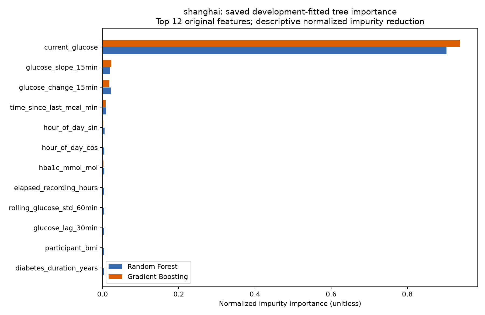
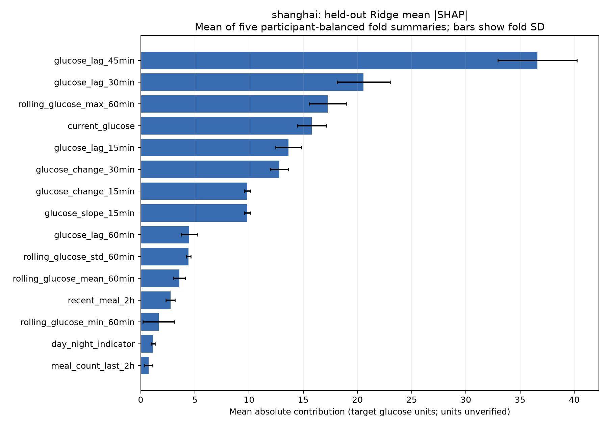
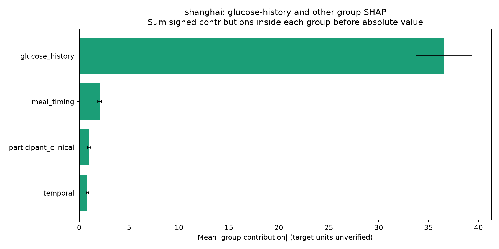
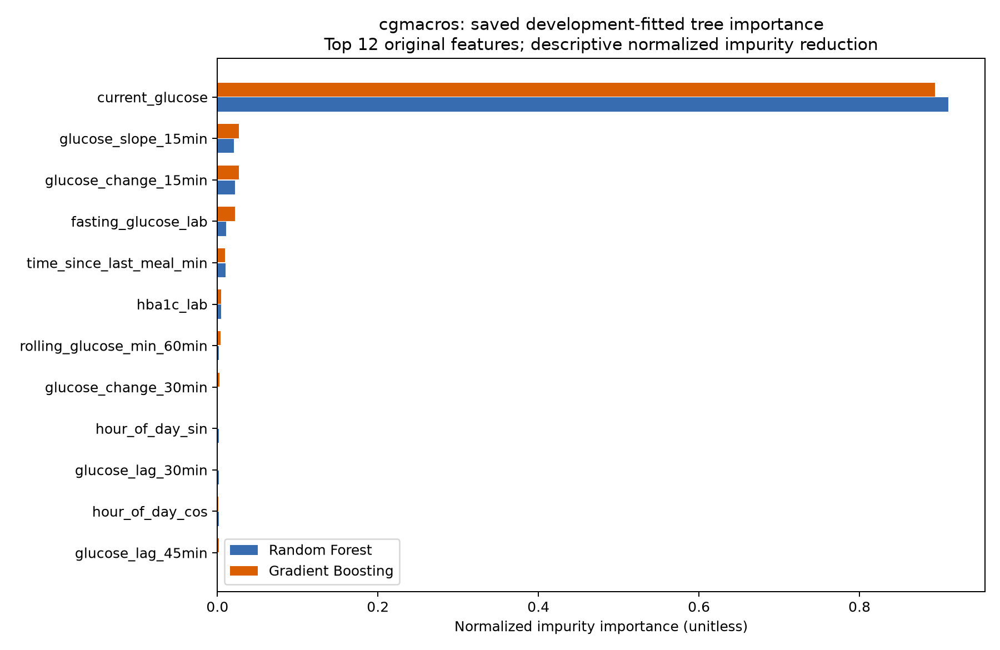
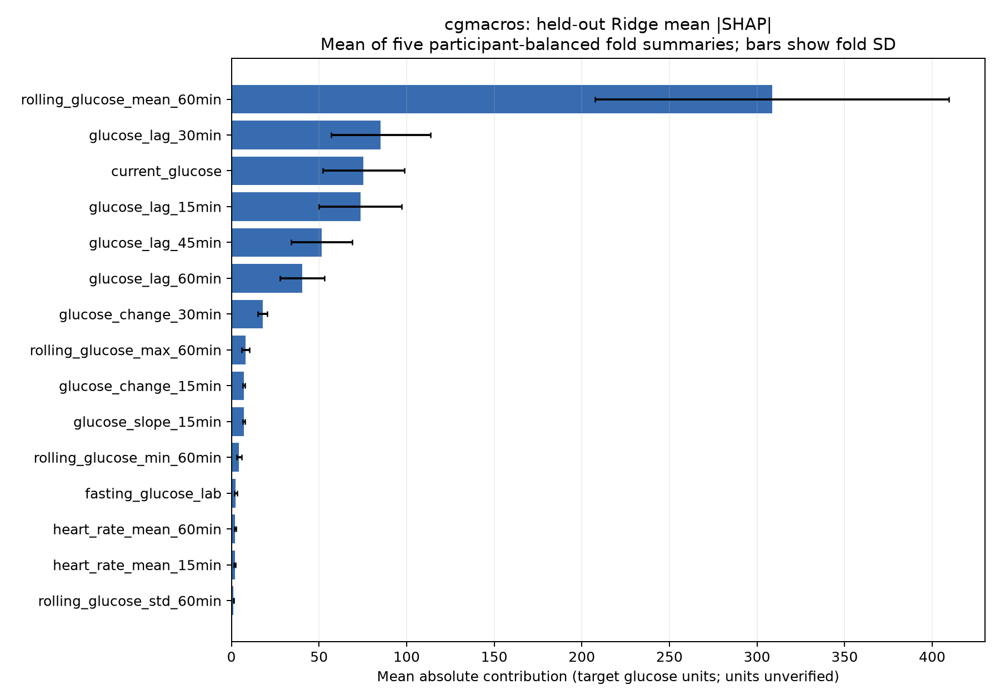
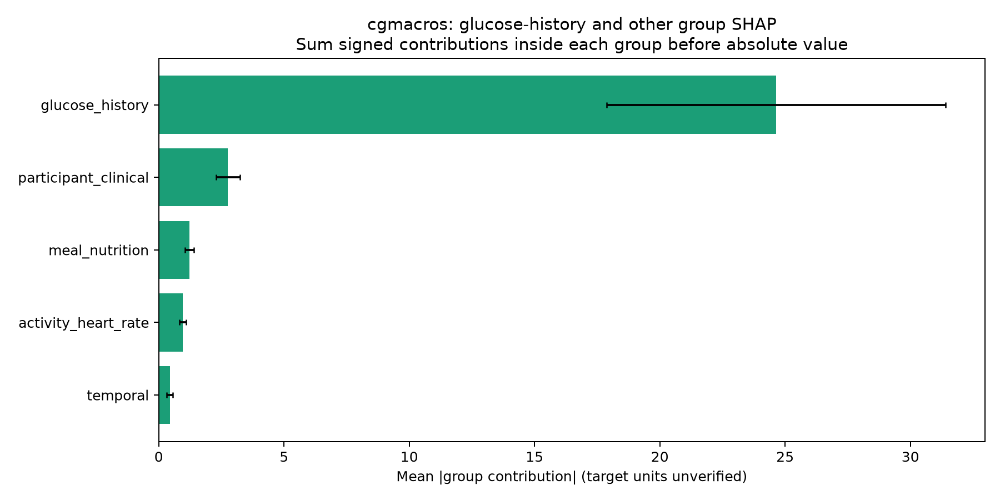

# Member 4: tree importance and SHAP explanations

Completed 2026-11-17 (Asia/Colombo). All approved features; Shanghai and CGMacros analyzed separately. Tree importance is descriptive of the original saved development-fitted models. Ridge SHAP explains only each cached model’s held-out development participants, using training-participant backgrounds.

## Methods and validation

Verified all four Random Forest/Gradient Boosting hashes against Member 3’s model inventory. The fitted preprocessor output positions, branch selectors and actual encoder categories map importance to original inputs. Shanghai sex expands into Female/Male indicators with no dropped reference. The transformed tree importances are summed for each original input; totals remain one. CGMacros retains participant_sex_code as an approved numeric feature, with code meanings unverified. Trees were not retrained.

SHAP 0.52.0 imported and ran without dependency changes. A bounded Shanghai Fold 1 pilot used 512 training-background rows and 384 held-out rows; it finished in 7.73 seconds including preparation, SHAP checks and local plots. The pilot was inspected before the remaining nine folds and reused in the full analysis.

Each background contains **8 rows per training participant**. Each explanation sample contains **24 rows per held-out participant**, deterministically subsampled from the prior permutation-importance sample. Sampling is target-blind; SHA-derived seeds use master seed 42. IDs, timestamps, exact development-row indices and selection seeds remain in ignored local CSVs. All training and validation participants are covered in their relevant roles, and background/explanation participants and source rows are disjoint. Locked-test participants are excluded. No predictive metadata or target columns are supplied to the model.

Both background and explanation inputs pass through the corresponding cached, training-fitted preprocessor. `shap.LinearExplainer` uses `shap.maskers.Independent` with an explicit `max_samples` equal to the entire background size, preventing default thinning of the balanced sample. Identity output/link, no target transform. Expected value is the fitted Ridge prediction averaged over that background. For this independent linear explanation, SHAP_j = coefficient_j × (transformed input_j − background mean_j).

This independent/interventional assumption breaks feature dependence; it is not a causal intervention or a correlation-conditional explanation. Correlated lags, changes, slopes and rolling features receive model-weight-based credits that can be large and cancel. One-hot columns are also treated as separate transformed variables; their signed attributions are then summed into the original sex feature. This aggregation preserves reconstruction, but is not a newly estimated conditional/cooperative game on original features.

For all ten folds, expected value + sum(SHAP) matched pipeline predictions: maximum absolute residual **7.96e-13**, using atol=1e-7 and rtol=1e-9. Predictions from the transformed estimator also matched the pipeline; SHAP values matched the analytical linear formula. No model fitting or dependency changes occurred. Four synthetic tests covered mapping with reordered branches/underscored categories, exact linear/additive checks, cancellation before absolute value, and deterministic balanced sampling/participant weighting.

The global summaries first average absolute contributions within each participant, then equally across held-out participants in that fold. The main aggregate equally weights the five fold summaries and reports descriptive fold SD/range. A separate participant-weighted aggregate weights folds by held-out participant count. It is not identical when folds differ in size. No repeated explanations are treated as independent participants; there are no p-values or confidence intervals.

Original-feature and group summaries sum **signed** transformed SHAP values per row before taking absolute values. Thus the group mean absolute contribution can be much smaller than the sum of individual mean absolutes when correlated features offset. All global units are target-glucose units, which remain unverified; no mg/dL/mmol/L label or conversion is applied.

## Findings

### shanghai

Across five folds, 80 distinct held-out participants and 1,920 rows were explained. Training background sizes vary with fold membership: 512, 504, 512, 512, 520.

Largest mean-absolute Ridge SHAP contributions: glucose_lag_45min: 36.6000; glucose_lag_30min: 20.5656; rolling_glucose_max_60min: 17.2573; current_glucose: 15.7828; glucose_lag_15min: 13.6458.

Random Forest top original inputs: current_glucose, glucose_change_15min, glucose_slope_15min, time_since_last_meal_min, hour_of_day_sin.

Gradient Boosting top original inputs: current_glucose, glucose_slope_15min, glucose_change_15min, time_since_last_meal_min, rolling_glucose_min_60min.







Descriptive Spearman ranking associations (not significance tests): ridge_shap_rank / heldout_permutation_rank: 0.992 (25 shared features); ridge_shap_rank / random_forest_rank: -0.026 (25 shared features); ridge_shap_rank / gradient_boosting_rank: 0.123 (25 shared features); ridge_shap_rank / ridge_numeric_rank: 0.992 (24 shared features); heldout_permutation_rank / random_forest_rank: -0.014 (25 shared features); heldout_permutation_rank / gradient_boosting_rank: 0.121 (25 shared features); heldout_permutation_rank / ridge_numeric_rank: 0.995 (24 shared features); random_forest_rank / gradient_boosting_rank: 0.775 (25 shared features); random_forest_rank / ridge_numeric_rank: -0.114 (24 shared features); gradient_boosting_rank / ridge_numeric_rank: 0.065 (24 shared features).

### cgmacros

Across five folds, 36 distinct held-out participants and 864 rows were explained. Training background sizes vary with fold membership: 232, 232, 232, 232, 224.

Largest mean-absolute Ridge SHAP contributions: rolling_glucose_mean_60min: 308.5342; glucose_lag_30min: 85.2776; current_glucose: 75.4090; glucose_lag_15min: 73.6489; glucose_lag_45min: 51.5200.

Random Forest top original inputs: current_glucose, glucose_change_15min, glucose_slope_15min, fasting_glucose_lab, time_since_last_meal_min.

Gradient Boosting top original inputs: current_glucose, glucose_slope_15min, glucose_change_15min, fasting_glucose_lab, time_since_last_meal_min.







Descriptive Spearman ranking associations (not significance tests): ridge_shap_rank / heldout_permutation_rank: 0.946 (39 shared features); ridge_shap_rank / random_forest_rank: 0.186 (39 shared features); ridge_shap_rank / gradient_boosting_rank: 0.367 (39 shared features); ridge_shap_rank / ridge_numeric_rank: 0.967 (39 shared features); heldout_permutation_rank / random_forest_rank: 0.181 (39 shared features); heldout_permutation_rank / gradient_boosting_rank: 0.327 (39 shared features); heldout_permutation_rank / ridge_numeric_rank: 0.977 (39 shared features); random_forest_rank / gradient_boosting_rank: 0.865 (39 shared features); random_forest_rank / ridge_numeric_rank: 0.158 (39 shared features); gradient_boosting_rank / ridge_numeric_rank: 0.330 (39 shared features).

## Why methods differ

Tree impurity reduction measures how the saved nonlinear model allocated splits during development fitting. Ridge coefficient magnitudes reflect conditional weights and preprocessing scale. Mean |SHAP| reflects fitted weight × distance from a particular training-background mean. Held-out permutation importance measures MAE change after disrupting inputs. The estimators, fitting/explanation scopes, samples and units differ, so only descriptive rank comparisons are made; raw numeric magnitudes are not compared across methods or datasets. Cross-method rank tables retain every approved original feature; Ridge coefficient rank is missing for categorical indicators to avoid mixing scales.

Impurity importance can favor continuous/high-cardinality features and can reflect training overfit. Correlated predictors can share or monopolize split credit. Summing dummy importance avoids treating one input as several distinct variables but does not eliminate selection bias. No held-out tree performance or tree-specific permutation importance is inferred from these saved MDI values.

The earlier Ridge analysis found nearly perfectly correlated glucose-change/slope features and strong rolling-mean/lag relationships. Negative or large SHAP contributions show model deviations from a reference prediction, not protective/risk factors. Expected values vary by fold/background. These independent SHAP values do not resolve collinearity or establish medical causation. The current sampling is row-based within each participant; temporal observations remain dependent, and results describe the selected windows. Model training itself remains the original row-weighted protocol.

## Local examples and scope limits

Local-example rule was declared before SHAP: Fold 1 only, first/middle/last sorted participant IDs, earliest timestamp in each participant’s selected explanation sample. Six waterfall PNGs, original-feature contribution CSVs and private example manifests are saved in `results/member4/shap/local/`. They reconstruct each corresponding prediction and are illustrative, not selected for errors, glucose levels or visually favorable SHAP. Row-level arrays, transformed inputs/backgrounds, predictions and selected IDs also stay there; this whole folder is ignored by Git.

No optional tree SHAP example was added: the four supplied trees are all-development fits, so explaining their development rows would be in-sample/descriptive and would not supply held-out tree evidence. The requested ten held-out Ridge explanations and tree MDI provide distinct, explicitly labeled scopes without additional tree fitting. SHAP was compatible; no fallback or environment modification was needed.

The prior original modeling-notebook manifest discrepancy and unverified glucose units remain unresolved, as documented in readiness reports. They were not silently repaired. All original model hashes used here match their inventory. No clustering or diagnostic interpretation was performed.

## Reproduction and outputs

```powershell
python -B notebooks/member4/test_tree_shap.py
python -B notebooks/member4/tree_shap_analysis.py --source-root C:\Users\mssmo\Documents\glucose\Smart_Glucose_Work
# Inspect reports/member4/tree_shap_pilot.json before scaling.
python -B notebooks/member4/tree_shap_analysis.py --source-root C:\Users\mssmo\Documents\glucose\Smart_Glucose_Work --all-folds
python -B notebooks/member4/report_tree_shap.py
python -B notebooks/member4/verify_tree_shap.py --source-root C:\Users\mssmo\Documents\glucose\Smart_Glucose_Work
```

Results: eight transformed/original tree-importance CSVs; ten feature maps, per-fold SHAP tables at transformed/original/group levels, combined fold and aggregate summaries, method comparison/rank-association tables, six global plots, and six local waterfall examples. Evidence includes model hashes, package versions, explainer settings, seeds, coverage, runtime, base values, error tolerances and protected-file checks. Local files must be preserved privately to reproduce identical selected-row explanations; the scripts also deterministically regenerate them from unchanged sources.

Protected source files checked: **252**, changed: **0**. Cached model/sidecar files checked: **20**, changed: **0**. Model fits: **0**. Final-test predictions: **0**. No commit or push was performed.

References: [SHAP LinearExplainer](https://shap.readthedocs.io/en/latest/generated/shap.LinearExplainer.html) and [scikit-learn tree-importance example and limitations](https://scikit-learn.org/stable/auto_examples/ensemble/plot_forest_importances.html).

**Final-test evaluation: NOT STARTED.**
